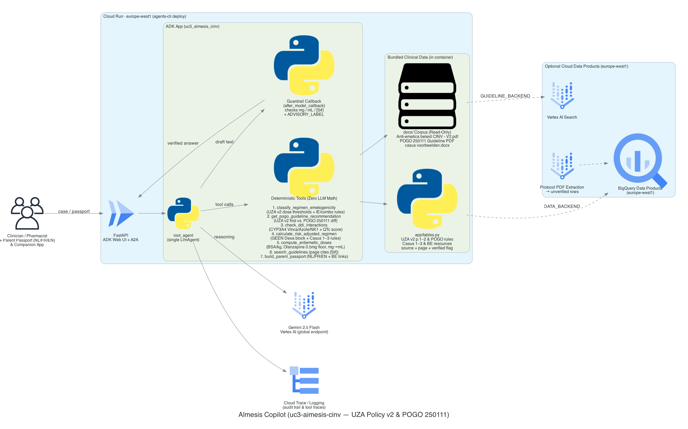

# Almesis Copilot — Pediatric CINV Clinical Decision Support

**Solve with Google: BSPHO 2026 — Use Case 3 (UZA Pediatric Oncology)**

**Live Cloud Run Deployment (`europe-west1`)**: [https://uc3-aimesis-cinv-745357398105.europe-west1.run.app/](https://uc3-aimesis-cinv-745357398105.europe-west1.run.app/)
- **Clinical & Parent Passport UI**: [https://uc3-aimesis-cinv-745357398105.europe-west1.run.app/ui/](https://uc3-aimesis-cinv-745357398105.europe-west1.run.app/ui/)
- **ADK Developer Trace UI**: [https://uc3-aimesis-cinv-745357398105.europe-west1.run.app/dev-ui/](https://uc3-aimesis-cinv-745357398105.europe-west1.run.app/dev-ui/)

> **Clinical Safety Notice**: Uses synthetic pediatric oncology data only. Non-autonomous clinical decision support — every recommendation is **"Advisory Only — Requires Clinician Sign-Off"**.

Almesis Copilot is a deterministic-first, AI-assisted clinical decision support application and multilingual parent passport generator for pediatric **Chemotherapy-Induced Nausea & Vomiting (CINV)**, grounded in the **UZA July 2026 v2 Policy** (`Anti-emetica beleid CINV - V2.pdf`) and the **POGO 250111 Emetogenicity Classification Guideline**.



---

## Key Features

1. **Deterministic Clinical Calculation Engine** (Zero LLM dose math):
   - Mosteller BSA calculation ($\sqrt{\text{height\_cm} \times \text{weight\_kg} / 3600}$), weight/BSA-based mg dosing, pediatric hard caps, Olanzapine `0.5 mg` downward rounding, and syringe volume (`mL`) conversion.
2. **Steroid Safety Gate (`GEEN Dexamethasone`)**:
   - Hard blocks Dexamethasone for **Acute Lymphoblastic Leukemia (ALL)**, **Brain Tumors (`hersentumoren`)**, and **Dinutuximab beta** protocols, automatically substituting with Ondansetron + Aprepitant.
3. **Interactive Multilingual Parent Passport (`NL` / `FR` / `EN`)**:
   - Displays liquid doses strictly in **milliliters (`mL`)** across **Morning (☀️)**, **Noon (🌤️)**, and **Evening (🌙)** cards, plus a **1-click downloadable PDF Parent Passport** and vomiting rescue rules (`< 30 min` vs. `> 30 min`).
4. **AI Clinical Assistant & Deterministic Guardrail**:
   - Powered by Google ADK (`gemini-2.5-flash`) with an `after_model_callback` guardrail (`app/guardrail.py`) that verifies every numerical dose, page citation, and mandatory advisory sign-off label.

---

## Step-by-Step Guide to Run Locally

### Step 1: Prerequisites

Ensure the following tools are installed on your machine:

1. **Python 3.11 – 3.13**
2. **[`uv`](https://docs.astral.sh/uv/getting-started/installation/)** (Python package & environment manager):
   ```bash
   curl -LsSf https://astral.sh/uv/install.sh | sh
   ```
3. **Google Cloud SDK (`gcloud`)** *(if using Vertex AI)* or a **Gemini API Key** *(if using Google AI Studio)*.
4. *(Optional)* **`google-agents-cli`**:
   ```bash
   uv tool install google-agents-cli
   ```

---

### Step 2: Navigate to the Application Directory & Install Dependencies

All application code lives inside `uc3-aimesis-cinv/`:

```bash
cd uc3-aimesis-cinv
uv sync
```

*(Alternatively, if you have `agents-cli` installed, you can run `agents-cli install`.)*

---

### Step 3: Configure Environment Variables (`.env`)

Copy the example environment file:

```bash
cp .env.example .env
```

Open `uc3-aimesis-cinv/.env` and choose **one** of the following authentication methods for the AI Clinical Assistant:

#### Option A: Google Cloud Vertex AI (Default)
1. Authenticate with Google Cloud:
   ```bash
   gcloud auth application-default login
   ```
2. Set your GCP project in `.env`:
   ```env
   GOOGLE_GENAI_USE_VERTEXAI=true
   GOOGLE_CLOUD_PROJECT=your-gcp-project-id
   GOOGLE_CLOUD_LOCATION=global
   ALLOW_UNVERIFIED=1
   ```

#### Option B: Gemini API Key (Google AI Studio — No GCP Project Required)
1. Update `.env` to use your Gemini API key:
   ```env
   GOOGLE_GENAI_USE_VERTEXAI=false
   GEMINI_API_KEY=your-gemini-api-key
   ALLOW_UNVERIFIED=1
   ```

> **Note:** Sections 1–3 of the Streamlit Clinical UI (Patient Profile, Clinician Dosing Plan in `mg`, and Daily Parent Passport in `mL` + PDF export) are **100% deterministic** and work offline even without LLM credentials. LLM credentials are only used for Section 4 (*Ask the clinical AI assistant*) and the ADK Dev UI.

---

### Step 4: Run the Application Locally

You can launch the application in three ways depending on your workflow:

#### Way 1: Run the Interactive Streamlit Clinical UI Directly (Fastest)
From inside `uc3-aimesis-cinv/`:

```bash
uv run streamlit run app/streamlit_app.py
```

- Opens in your browser at: **[http://localhost:8501](http://localhost:8501)**

#### Way 2: Run the Full FastAPI Server (Streamlit UI + ADK Dev UI + A2A Endpoint)
From inside `uc3-aimesis-cinv/`:

```bash
uv run uvicorn app.fast_api_app:app --host 0.0.0.0 --port 8000
```

- **Clinical & Parent UI (Streamlit):** [http://localhost:8000/ui/](http://localhost:8000/ui/) *(root `/` automatically redirects here)*
- **ADK Developer Trace UI:** [http://localhost:8000/dev-ui/](http://localhost:8000/dev-ui/)
- **A2A Protocol Endpoint:** `http://localhost:8000/a2a/app`

*(Or run `agents-cli playground` to start the ADK Playground with auto-reload.)*

#### Way 3: Run with Docker
From inside `uc3-aimesis-cinv/`:

```bash
docker build -t almesis-copilot .
docker run --rm -p 8080:8080 --env-file .env almesis-copilot
```

- Open **[http://localhost:8080/ui/](http://localhost:8080/ui/)** in your browser.

---

### Step 5: Run Tests & Code Quality Checks

From inside `uc3-aimesis-cinv/`:

1. **Run Unit & Integration Tests** (BSA, dosing caps, steroid safety gates, guardrails, PDF passport):
   ```bash
   uv run pytest tests/unit tests/integration
   ```
2. **Run Linter & Type Checks**:
   ```bash
   agents-cli lint
   ```
3. **Run Agent Evaluation Suite**:
   ```bash
   agents-cli eval run
   ```

---

## Repository Structure

```text
hack-with-google-2026/
├── README.md                        # This step-by-step local setup guide
├── almesis-copilot.md               # Unified product plan, clinical cases & build spec
├── demo/                            # Video demonstration recording
├── media/                           # System architecture diagram & generator script
└── uc3-aimesis-cinv/                # Main ADK + FastAPI + Streamlit application
    ├── .env.example                 # Environment variable template
    ├── Dockerfile                   # Container build for Cloud Run / local Docker
    ├── pyproject.toml               # Python dependencies managed by uv
    ├── app/
    │   ├── streamlit_app.py         # Multilingual (NL/FR/EN) Clinical & Parent Passport UI
    │   ├── fast_api_app.py          # FastAPI server hosting /ui/, /dev-ui/, and /a2a/
    │   ├── agent.py                 # ADK root_agent (gemini-2.5-flash) & 7 clinical tools
    │   ├── dosing.py                # Deterministic BSA, mg, rounding & mL dosing calculator
    │   ├── tables.py                # Clinician-verified UZA v2 & POGO 250111 tables
    │   ├── passport.py              # Parent schedule builder & fpdf2 PDF generator
    │   ├── guidelines.py            # Page-cited PDF guideline search
    │   └── guardrail.py             # Deterministic after_model_callback safety guardrail
    ├── docs/                        # Official UZA CINV v2 & POGO 250111 PDFs + clinical cases
    └── tests/                       # Unit, integration, and evaluation test suites
```
