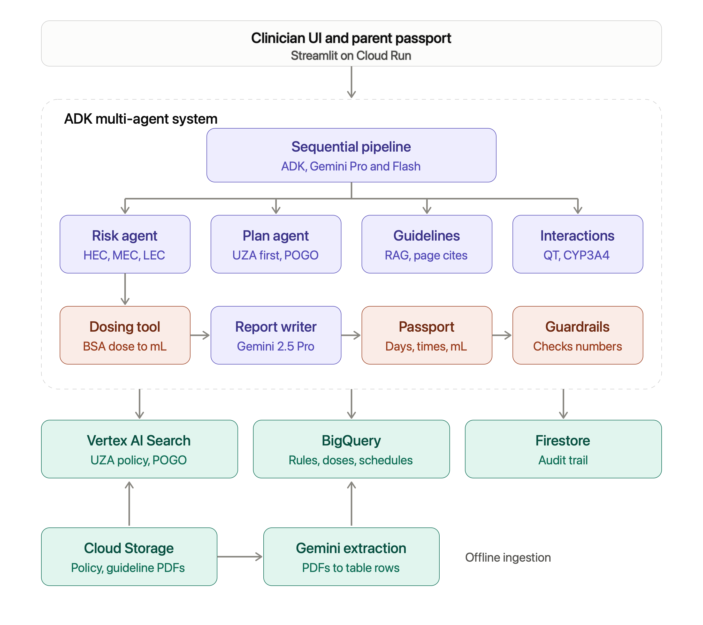

# Almesis Copilot 

A guide to the whole project: what it is, how it works, and how to pitch it.

## The idea in one sentence

A clinician types in a child's chemotherapy and basic details, and Almesis Copilot answers: how likely is this treatment to make the child sick, which anti-sickness medicines are recommended, what dose, whether any of the child's other medicines clash with them, and which guideline says so.

## The problem it solves

Chemotherapy often causes nausea and vomiting (CINV). Doctors prevent it with anti-sickness medicines, but choosing the right ones for a child is hard:

- Every chemotherapy drug makes people sick to a different degree.
- Children need doses based on weight or body size, so adults' numbers do not work.
- The anti-sickness medicines can clash with other medicines the child takes.
- The guidelines are long documents, and the information is scattered.

Today, clinicians search these documents by hand. Almesis puts it all in one place, in seconds, with the source shown.

## Think of it as a small expert team

Imagine a hospital meeting room with six specialists. Each one has one job, and they pass notes to each other in order.

| Team member             | What they do in plain words                                                            |
| ----------------------- | -------------------------------------------------------------------------------------- |
| Risk agent              | Looks up the chemotherapy and says: low, moderate or high chance of sickness           |
| Plan agent              | Picks which anti-sickness medicines are needed for that risk level and this child      |
| Guideline agent         | Searches the official guidelines and brings back the exact passages, with page numbers |
| Interaction agent       | Checks the child's other medicines for dangerous clashes                               |
| Dosing tool             | Calculates the dose from the child's weight and size (this is plain code, not AI)      |
| Writer (Gemini 2.5 Pro) | Turns everything above into one clear, readable answer                                 |
| Guardrail agent         | Last check: are all the numbers and sources in the answer real?                        |

The agents run in a fixed order (the first two one after another, the next three at the same time, then the writer, then the guardrail). We build this with Google's Agent Development Kit (ADK).

## What happens when you press the button

1. The clinician enters age, weight, height, the chemotherapy drugs, current medicines, and whether the child had CINV before.
2. The risk agent finds the sickness risk from a table of chemotherapy drugs.
3. The plan agent picks the anti-sickness medicines for that risk (for example, a previous bad experience can add one more medicine).
4. Three specialists work at the same time: guidelines are searched, interactions are checked, doses are calculated.
5. The writer combines everything into a short report with a table, warnings and sources.
6. The guardrail checks the report. If a dose or a source does not match the facts, it removes that sentence.
7. The screen shows the final plan, plus a trace of which agent did what.

## Why it is safe (the most important part)

Medicine is high stakes, so the design follows four rules:

- **AI never does the math.** Doses are calculated by normal code. The AI only explains the result.
- **Facts come from tables, not from the AI's memory.** Risk levels, plans, doses and interactions live in a database that a clinician checks.
- **Everything has a source.** Each claim points to a guideline passage with a page number.
- **Unchecked data is blocked.** Every table row has a verified flag. Rows nobody has checked are not used in a real setting.

The result always ends with: Decision support only. Requires clinician review. The tool helps the doctor; it does not replace the doctor.

## The Google Cloud Architecure

| Google service              | What it does here                                                  |
| --------------------------- | ------------------------------------------------------------------ |
| Gemini (on Vertex AI)       | The AI brain that reads, searches and writes                       |
| ADK (Agent Development Kit) | Connects the agents into one team                                  |
| BigQuery                    | The database with risk levels, doses and interaction rules         |
| Vertex AI Search            | Searches the guideline PDFs and returns passages with page numbers |
| Cloud Storage               | Stores the PDF files                                               |
| Firestore                   | Keeps a record of every answer for auditing                        |
| Cloud Run                   | Hosts the web app so anyone can open it with a link                |

Everything runs in European regions, which matters for Belgian hospitals.

## The bonus feature: reading protocols

A user can upload a long clinical trial protocol PDF. Gemini reads it and pulls out the chemotherapy drugs, doses, and the page and sentence each came from. These are saved as unchecked rows, and a clinician approves them before they are used. This builds the structured database the challenge asks for.

## The 3-minute demo story

1. **Enter a child (cisplatin, 7 years, 24 kg).** The screen shows high risk, a medicine plan, and sources with page numbers.
2. **Add a medicine that clashes (voriconazole).** A warning appears.
3. **Change the weight.** The doses change, and you can show the exact formula. Say: the AI never does the math.
4. **Upload a protocol PDF.** The drugs appear in a table with their page and quote.
5. **Close with safety.** Guardrail, sources, clinician review, European data.

## Lines you can use with the judges

- One focused product, not four shallow ones: the other use cases (protocol search, Pediatric Prescriber) reuse the same agents.
- Built so a clinician can check every claim, which is what makes it usable in a hospital.
- Uses the full Google stack for real reasons: Gemini, ADK multi-agent, Vertex AI Search, BigQuery, Cloud Run.
- Safety by design: calculations in code, citations, a guardrail and a verification flag.

## Honest limits to mention

- Only made-up patients are used.
- The sample tables are placeholders until a clinician checks them against the guidelines.
- It is a decision-support prototype, not a medical device.

## Mini glossary

- **CINV:** chemotherapy-induced nausea and vomiting.
- **Emetogenicity:** how likely a drug is to cause vomiting.
- **Agent:** an AI helper with one job and its own tools.
- **RAG:** the AI first searches documents, then answers using what it found.
- **Guardrail:** a final check that blocks wrong or unsupported answers.
- **BSA:** body surface area, a body-size number used to dose children.
- **ADK:** Google's toolkit for building teams of agents.

## The organizers' brief

The organizers showed four steps for this use case. Here is how our solution lines up, in simple words.

| Their step                         | What our app does                                                                                                                  |
| ---------------------------------- | ---------------------------------------------------------------------------------------------------------------------------------- |
| 1. Emetic risk tiering             | Sorts the chemotherapy into HIGH (HEC), MODERATE (MEC) or LOW (LEC) risk, including regimens that run for several days             |
| 2. Cross-check hospital guidelines | Uses the UZA July 2026 policy first, compares it with the POGO guideline, and shows a guideline match or mismatch badge            |
| 3. Check patient characteristics   | Uses age, weight, body surface area and earlier nausea to fit the dose to the child and round it to a practical amount in mL       |
| 4. Antiemetic passport for parents | A day-by-day card for days at home: times, medicine, amount in mL, and clinician-written instructions, in English, Dutch or French |

Two new team members join the six specialists:

- **Passport writer:** turns the checked schedule into a plain-language card for parents. It copies the instruction and rescue texts that a clinician wrote; it never invents medical advice.
- **Passport guardrail:** checks every time and every amount in the card against the calculated schedule and removes anything that does not match.

The new demo ending: change the child's weight, watch the mL amount change, then switch the passport to Dutch.
